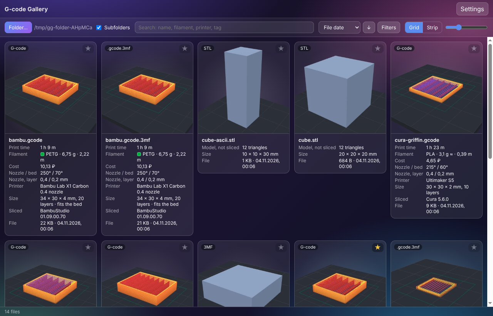
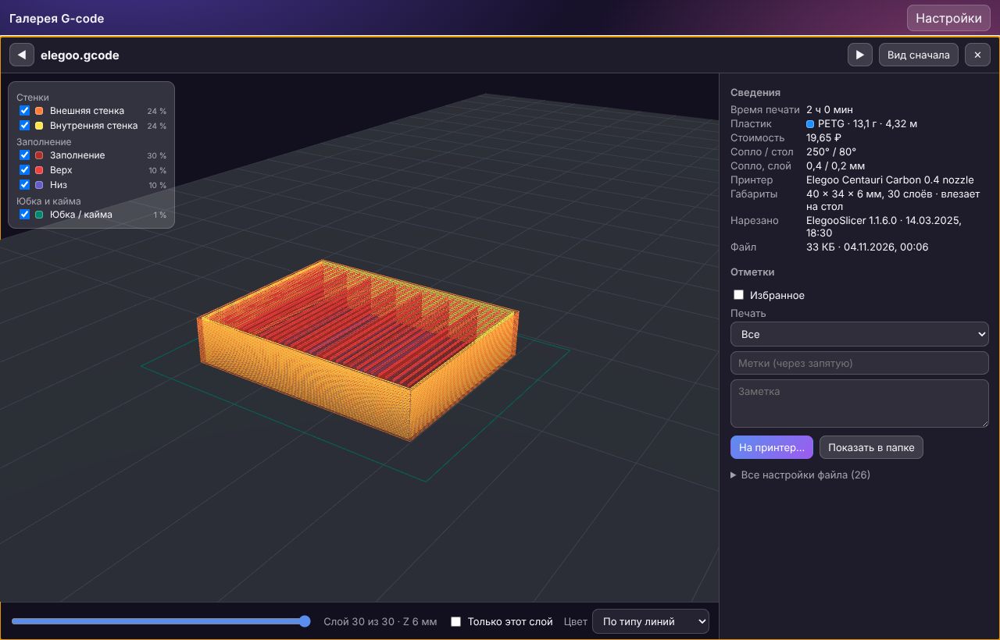
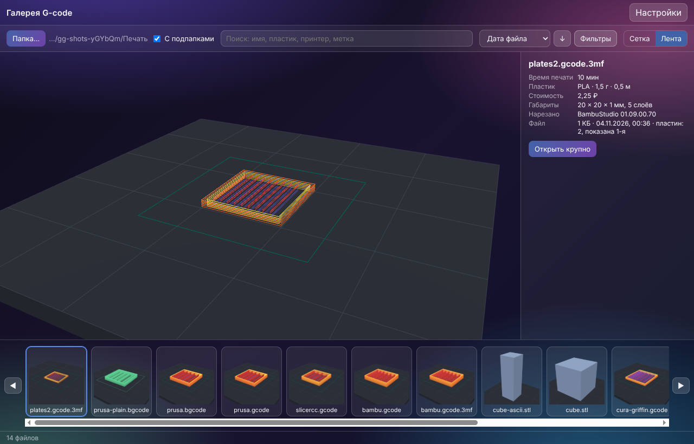
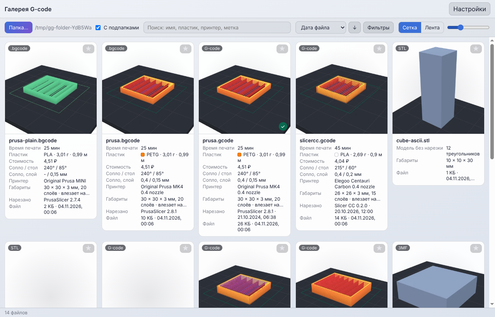
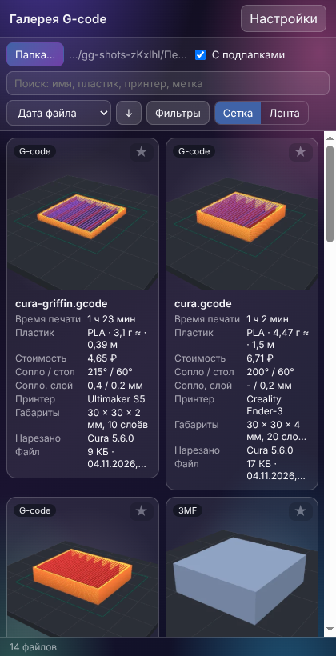

<div align="center">

# GcodeGallery

**Point it at a folder and see every G-code file as a 3D preview of its toolpath, with print time, filament,
printer and size under each one. Find the part you need in seconds, or just look through what you have.**

[Русский](README.ru.md)

[](CHANGELOG.md) [](https://github.com/ALEXalesha/GcodeGallery/actions/workflows/ci.yml) [](LICENSE) [](https://developer.mozilla.org/docs/Web/JavaScript) [](https://www.electronjs.org/) [](https://threejs.org/) [](https://claude.com/claude-code)

</div>

Code, tests and docs were written by Claude (Anthropic) in Claude Code; ideas, review and decisions are Alexey's.



## What it does

- **A gallery of a folder.** Pick a folder (subfolders too) and every print file becomes a tile with its own 3D
  preview of the toolpath, all from the same angle. Hover a tile and the model turns while the layers grow.
  While the 3D is being built, the picture stored in the file is shown. New files show up on their own.
- **Grid or strip.** A grid of tiles with a size slider, or a strip: one large model on top and small ones below,
  arrow keys to flip through, Enter to open large.
- **Under each preview:** print time, grams and meters of filament and its cost by your spool price, filament type
  and temperatures, nozzle and layer height, the printer it was sliced for, size X×Y×Z, layer count and whether it
  fits on the bed, the slicer, the date and the file size.
- **Search, sort, filter** by name, filament, printer, tags, time, weight, date, file type.
  Favorites, your own tags, a note per file, "printed / not printed". Marks are stored apart from the files:
  **print files are never changed** (there is a test for it).
- **Open large:** a big 3D view with a layer slider ("this layer only" too), colors by line type (walls, infill,
  supports, bridges...) or in the filament color, a legend with a share of time per type, and every setting
  stored in the file.
- **Send to the printer** (Elegoo Centauri Carbon over the network, SDCP, the same code as in
  [Slicer CC](https://github.com/ALEXalesha/Slicer)): upload only, or upload and print. **Printing starts only
  after you press "Print" in the system confirmation window** (Enter means "Cancel"); only then does the main
  process give a one-time token for that file - code in the window cannot press it.
- **Formats:** `.gcode` (OrcaSlicer, Elegoo Slicer, Slicer CC, PrusaSlicer, Bambu Studio, Cura), `.gcode.3mf`
  (Bambu Studio, OrcaSlicer), `.bgcode` (PrusaSlicer binary G-code: heatshrink, MeatPack, CRC32 - checked against
  real PrusaSlicer 2.6 and 2.8.1 files), plain `.3mf` and `.stl` (the model itself).
- Big folders stay fast: parsing runs in worker threads, visible tiles first; results are cached by
  path + size + date, so the second opening is instant.
- Five themes (glass, light, formal, night, warm - the same as in Paint and Slicer CC), Russian and English,
  a narrow window does not break, the window remembers its size and place.

| Open large | Strip | Light theme | Narrow window |
| --- | --- | --- | --- |
|  |  |  |  |

## Run

You need [Node.js](https://nodejs.org/) 22 or newer.

```bash
npm install
```

```bash
npm start
```

Build a Windows installer and a portable exe (run on Windows):

```bash
npm run dist
```

## Tests

| What | Command |
| --- | --- |
| Laws on random inputs with a seed (`GG_SEED=123` repeats a run) | `npm test` |
| Branch coverage with limits: core >= 90 %, all code without windows >= 80 % ([report](docs/coverage.md)) | `npm run coverage` |
| The real Electron window, invisible (Playwright) | `npm run test:app` (on Linux: `xvfb-run -a npm run test:app`) |
| Mutation check: every law catches its own mutant | `npm run mutate` (`node tools/mutate.js --core` without the window) |
| Real PrusaSlicer files from libbgcode: commands, pictures, size and fits-on-bed (in CI too) | `node tools/check-bgcode-ref.js <libbgcode>/tests/data` |

Sample files of every slicer are in `tests/fixtures` (made by `npm run fixtures`, the reference values are in
`expected.json`). Printing is tested only on a fake printer (`tests/support/fake-printer.js`).

## Inside

- `src/core` - parsing and everything without a window (Node): formats, metadata, cache, folder, marks, printing.
- `src/shared` - code shared with Slicer CC: G-code layers, ZIP, 3MF/STL, SDCP and sending to the printer
  ([SOURCE.md](src/shared/SOURCE.md) says where each file came from and what was added).
- `src/gallery` - the gallery itself, a module without its own window: `createGallery(root, host)`.
  It will become a tab in Slicer CC. `table3d.js` is the bed under the model, made in code for now
  (to be replaced with the Blender model).
- `src/renderer`, `electron` - the window around the gallery.

## License

[MIT](LICENSE)
