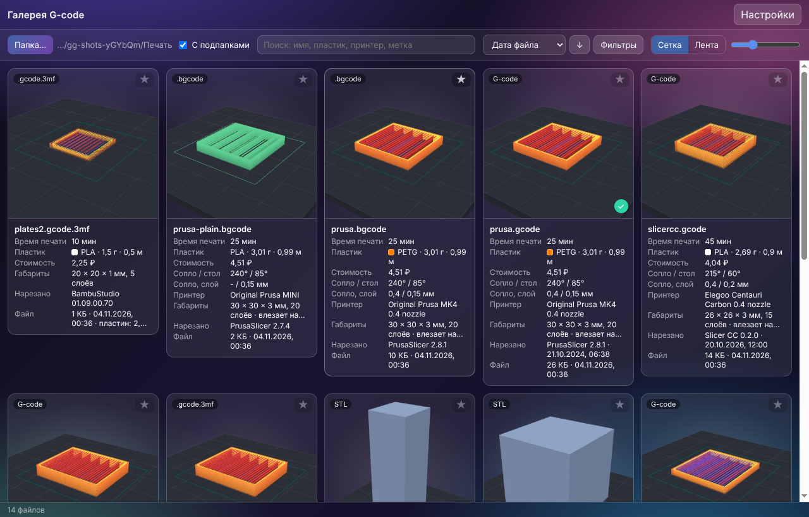
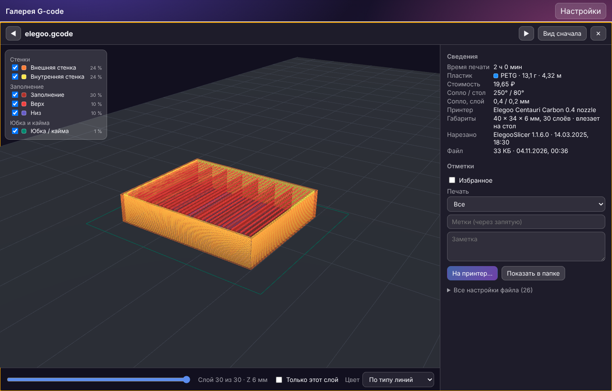
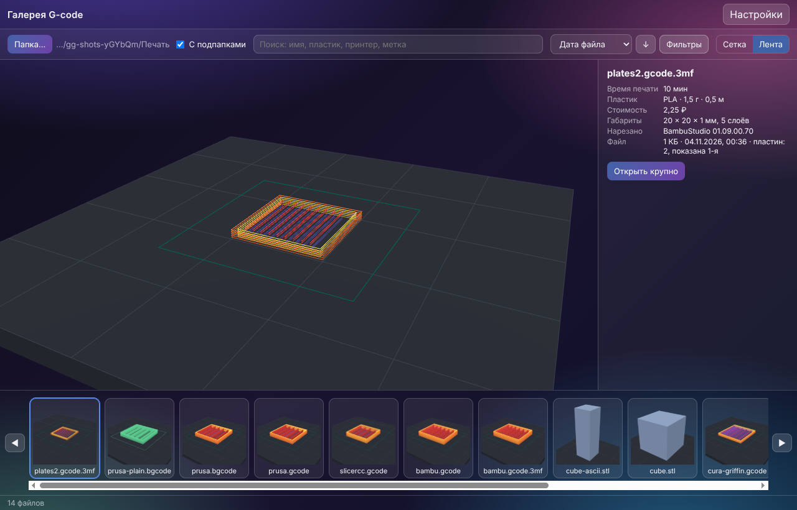
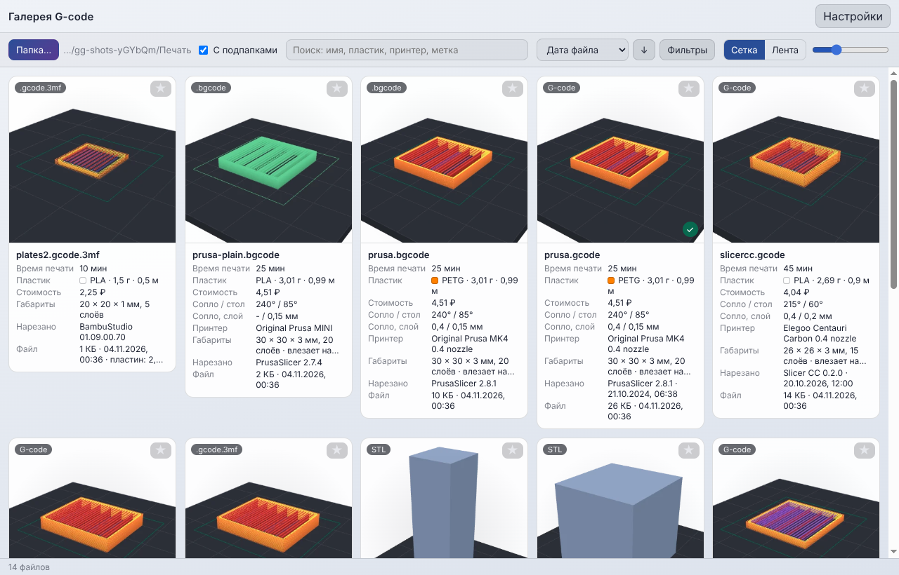
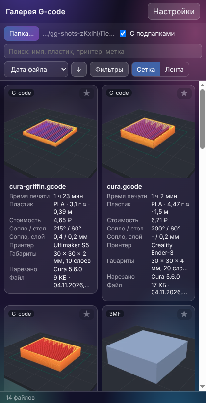

<div align="center">

# GcodeGallery

**Укажите папку - и каждый G-code в ней видно 3D-превью пути сопла, а под ним время печати, пластик, принтер и
размер. Нужная деталь находится за секунды, а можно и просто осмотреть, что лежит.**

[English](README.md)

[](CHANGELOG.md) [](https://github.com/ALEXalesha/GcodeGallery/actions/workflows/ci.yml) [](LICENSE) [](https://developer.mozilla.org/docs/Web/JavaScript) [](https://www.electronjs.org/) [](https://threejs.org/) [](https://claude.com/claude-code)

</div>

Код, тесты и документацию написал Claude (Anthropic) в Claude Code; идеи, проверка и решения - Алексея.



## Что умеет

- **Галерея папки.** Выбираете папку (с подпапками) - каждый файл печати становится плиткой со своим 3D-видом пути
  сопла, у всех один ракурс. Наведёте мышь - модель поворачивается, слои растут. Пока 3D считается, видна
  картинка из самого файла. Новые файлы появляются сами.
- **Сетка или лента.** Сетка плиток с ползунком размера или лента: крупная модель сверху, маленькие снизу,
  листать стрелками, Enter - открыть крупно.
- **Под превью:** время печати, граммы и метры пластика и стоимость по цене катушки, тип пластика и температуры,
  сопло и высота слоя, для какого принтера нарезано, габариты X×Y×Z, число слоёв и влезает ли на стол, чем
  нарезано, дата и размер файла.
- **Поиск, сортировка, фильтры** по имени, пластику, принтеру, меткам, времени, весу, дате, виду файла.
  Избранное, свои метки, заметка, «напечатано / не печаталось». Отметки хранятся отдельно:
  **файлы печати не меняются никогда** (на это есть закон в тестах).
- **Открыть крупно:** большое 3D с ползунком слоёв (и «только этот слой»), цвет по типу линий (стенки, заполнение,
  поддержки, мосты…) или цветом пластика, легенда с долей времени каждого типа, все настройки из файла.
- **На принтер** (Elegoo Centauri Carbon по сети, SDCP, тот же код, что в
  [Slicer CC](https://github.com/ALEXalesha/Slicer)): только загрузить или загрузить и печатать.
  **Печать начинается только после кнопки «Да, печатать»** - главный процесс выдаёт одноразовый жетон только на это
  нажатие.
- **Форматы:** `.gcode` (OrcaSlicer, Elegoo Slicer, Slicer CC, PrusaSlicer, Bambu Studio, Cura), `.gcode.3mf`
  (Bambu Studio, OrcaSlicer), `.bgcode` (двоичный G-code PrusaSlicer: heatshrink, MeatPack, CRC32 - сверено с
  настоящими файлами PrusaSlicer 2.6 и 2.8.1), обычные `.3mf` и `.stl` (сама модель).
- Большие папки не тормозят: разбор в потоках-работниках, видимые плитки первыми; итог в кэше по пути + размеру +
  дате, второе открытие - сразу.
- Пять тем (стеклянная, светлая, строгая, ночная, тёплая - как в Paint и Slicer CC), русский и английский,
  узкое окно не ломается, окно помнит размер и место.

| Крупно | Лента | Светлая тема | Узкое окно |
| --- | --- | --- | --- |
|  |  |  |  |

## Как запустить

Нужен [Node.js](https://nodejs.org/) 22 или новее.

```bash
npm install
```

```bash
npm start
```

Установщик и переносная версия для Windows (собирать на Windows):

```bash
npm run dist
```

## Тесты

| Что | Команда |
| --- | --- |
| Законы на случайных входах с зерном (`GG_SEED=123` повторяет прогон) | `npm test` |
| Покрытие по ветвям с порогами: ядро >= 90 %, весь код без окон >= 80 % ([отчёт](docs/coverage.md)) | `npm run coverage` |
| Настоящее окно Electron, невидимое (Playwright) | `npm run test:app` (в Linux: `xvfb-run -a npm run test:app`) |
| Мутационная проверка: каждый закон ловит свой мутант | `npm run mutate` (`node tools/mutate.js --core` - без окна) |
| `.bgcode` против настоящих файлов PrusaSlicer из libbgcode | `node tools/check-bgcode-ref.js <libbgcode>/tests/data` |

Образцы файлов каждого слайсера лежат в `tests/fixtures` (их делает `npm run fixtures`, эталон - `expected.json`).
Печать проверяется только на поддельном принтере (`tests/support/fake-printer.js`).

## Внутри

- `src/core` - разбор и всё без окна (Node): форматы, сведения, кэш, папка, отметки, печать.
- `src/shared` - общий со Slicer CC код: слои G-code, ZIP, 3MF/STL, SDCP и отправка на принтер
  ([SOURCE.md](src/shared/SOURCE.md): откуда каждый файл и что добавлено).
- `src/gallery` - сама лента, модуль без своего окна: `createGallery(root, host)`. Потом станет вкладкой в
  Slicer CC. `table3d.js` - стол под моделью, пока сделанный кодом (заменится моделью из Blender).
- `src/renderer`, `electron` - окно вокруг ленты.

## Лицензия

[MIT](LICENSE)
